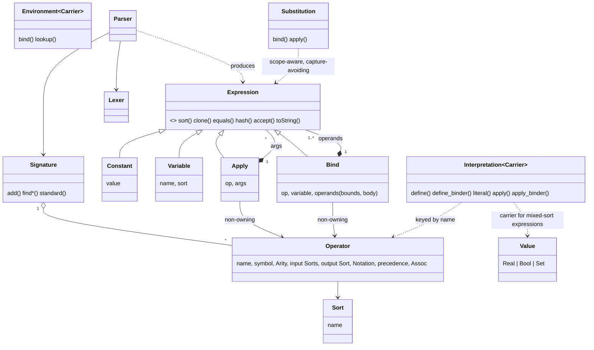

# Core (symbolic expressions) Architecture

`core` is the syntax layer of cppmath: immutable term trees, a vocabulary of operators, a parser and printer for them, and pluggable *interpretations* that give a tree a value. This document describes **how core is built**. What to do next (status, roadmap, open questions) is in [plans/core/plan.md](../../plans/core/plan.md).

## Goal and design rule

Everything else (calculus, simplification, set parsing, algebraic evaluation) is a *consumer* of core. Nothing in core knows about `double`, `sin`, or the reals except through a registered `Signature` and `Interpretation`.

**Separate syntax from semantics.**
- *Syntax* (sorts, operators, signatures, terms, parser, printer) knows only shapes.
- *Semantics* (interpretations, environments, evaluation) maps shapes into a carrier type.

## Class overview



## Data flow

```
text --Lexer--> tokens --Parser (reads Signature)--> Expression tree
Expression --Interpretation<C> + Environment<C>--> C               (evaluate; binder bodies are evaluated lazily, per value)
                                                                   (C = double, FiniteFieldElement, or Value = Real | Bool | Set)
Expression --fold--> anything                                      (print, free_variables, node_count, ...)
Expression --Substitution--> Expression                            (scope-aware, capture-avoiding)
Expression --simplify--> Expression                                (identities, exact constant folding)
Expression --calculus::differentiate--> Expression                 (rule table keyed by operator name, then simplify)
Expression --Printer--> text            (toString; parse(print(e)) equals e)
```

## Key points

- **One node kind for all operations.** `Apply(op, args)` replaces a class per operator. Adding an operator is one `Signature::add()`; the parser, printer and evaluator pick it up with no other change. Its constructor checks arity and argument sorts, so every `Apply` is well-sorted.
- **Signature outlives expressions.** `Apply` stores a `const Operator*`. `Signature::standard()` is a function-local static and always safe. Equality compares operators by *name*, so trees built from a copied/extended Signature still match.
- **`fold` is the traversal for results.** Printing, `free_variables`, `node_count` and `tree_depth` are folds. `transform` is a bottom-up rewrite, but it is not scope-aware, so `Substitution` has its own recursion.
- **Binders.** `sum(i, lo, hi, body)` is a `Bind`: the variable is in scope only in the body (the last operand), never in the bounds. That is why `evaluate` is a visitor rather than a fold (the body is evaluated once per value, in a child `Environment`), why `free_variables` subtracts the variable from the body only, and why `Substitution` never replaces a shadowed variable and renames a binder's variable (`i` → `i_1`) only when a replacement would otherwise be captured. Compare trees up to renaming with `alpha_equivalent`; `equals()` is syntactic.
- **Several sorts in one expression.** `x in [0, 1) U {5} and y < 3` mixes Reals, Sets and Bools. The carrier is `Value`, a tagged union with checked accessors, and `evaluate_value` interprets the whole vocabulary over it. Sorts are checked when a tree is built; the one exception is `=`/`!=`, which accept any sorts and check at evaluation that both sides match (general overload resolution is deferred until a second sort-polymorphic symbol, such as matrix `*`, needs it).
- **Brackets and aliases.** Interval and set literals (`[a, b)`, `(a, b]`, `{a, b}`) are `Notation::Bracket` operators; `(` is a grouping unless a comma follows the first expression, which makes it an interval. Unicode spellings (`∈ ∪ ≤ ∧ ...`) are aliases: read, never printed. The printed forms match what `sets::Set::toString()` prints, so the sets library's own text parses.
- **Declared sorts.** The sort of a variable can't be read from text, so `Parser::parse(source, declarations)` takes a map of names to sorts; undeclared names are Reals.
- **Reserved words.** Atoms, function names, binder names and word operators (`U`, `in`, `and`, `or`, `not`) cannot be variable names, since the printed text would parse back as something else.
- **Canonical text.** `toString()` is fully parenthesised (`(x + 1)`, `sin(x)`, `(-x)`) and numbers use the shortest text that parses back exactly (`utils::format_number`, shared with `sets`), so `parse(e.toString())` equals `e`. For that to hold, a `Constant` is never negative (negatives are `neg(literal)`) and a `Variable` can't be named like an atom (`pi`, `e`).
- **Evaluation errors.** Unbound variable or undefined operator: `std::out_of_range`. Bad domain (`1/0`, `log(0)`, `sqrt(-1)`, NaN `pow`): `std::invalid_argument`. Parse failures: `ParseError` (an `invalid_argument` carrying a `SourceSpan`).
- **Consumers live outside core.** `abstract_algebra::example::finite_field_interpretation` evaluates a parsed tree in Z/pZ; `calculus::differentiate` uses a rule table keyed by operator name (copy `DerivativeRules::standard()` and `define` a rule for a new operator); `core::simplify` tidies results. Dependencies point toward `core`, never from it.

## Mathematical model

The class design is meant to keep this table true; a later `cppmath::category` namespace can treat these classes as instances without rewriting core.

| Math | Class | Category-theory reading |
|---|---|---|
| Sort (type of a term: Real, Bool, Set, ...) | `Sort` | object |
| Operation symbol `f : s₁ × … × sₙ → s` | `Operator` | generating (multi)morphism |
| Many-sorted signature Σ | `Signature` | presentation of a (multi)category / Lawvere theory |
| Terms over Σ with variables X | `Expression` (`Constant`, `Variable`, `Apply`, `Bind`) | free Σ-algebra T_Σ(X) (with binding) |
| Σ-algebra with carrier A | `Interpretation<A>` | algebra for the signature functor |
| Many-sorted Σ-algebra | `Interpretation<Value>`, where `Value` is a tagged union of the sorts' carriers | one carrier per sort |
| Variable assignment X → A | `Environment<A>` | arrow out of the generators |
| Evaluation | `evaluate` (a fold, with lazy binder bodies) | unique homomorphism T_Σ(X) → A (initiality) |
| Substitution X → T_Σ(Y) | `Substitution`, `compose` | Kleisli arrow / composition for the term monad |

## Architecture as built

Core headers are under `include/cppmath/core/`; every public declaration carries a Doxygen comment (see the Documentation rules in [CLAUDE.md](../../CLAUDE.md#documentation)).

### Layer 0: sorts and operators (syntax metadata)
- **`Sort`**: a named tag compared by name, so other modules can add sorts (`Matrix`, `Group`, ...) without editing core. Built-ins: `Real`, `Bool`, `Set`, `Any`. `Sort::accepts(actual)` treats `Any` as a wildcard on either side. `standard()` uses all four (`Any` only for `=` and `!=`).
- **`Operator`**: immutable descriptor with `name` (canonical, unique in a signature, e.g. `"add"`), `symbol` (printed token, e.g. `"+"`), `Arity` (`fixed(n)` or `at_least(n)`), input sorts, output sort, `Notation`, `precedence`, `Assoc`, `Properties {associative, commutative}`, and for binders a `bound_sort`. It has **no evaluation code**: meaning comes from interpretations, derivatives from a rule table in `calculus`.
  - `Notation`: `Atom` (`pi`), `Prefix` (`-x`, `not p`), `Infix` (`x + y`, `A U B`), `FunctionCall` (`sin(x)`, `max(x, y, z)`), `Binder` (`sum(i, 1, 10, body)`), `Bracket` (`[a, b)`, `{a, b, c}`).
  - `Assoc`: `Left` or `Right`.
  - The constructor enforces the shape the parser relies on: Atom/Prefix/Infix must have fixed arity 0/1/2; a binder has fixed arity ≥ 1 (its operands, the last being the body; the bound variable is *not* an argument); a bracket operator's symbol is exactly two characters, an opener from `( [ {` then a closer from `) ] }`; a non-variadic operator lists exactly `arity` input sorts; a variadic one lists at least one and reuses the last for extra arguments.
- **`Signature`**: owns operators at stable heap addresses (non-copyable, movable). `add()` rejects a duplicate name or a duplicate (notation, symbol) pair; `add_alias(alias, op_name)` lets a second spelling be *read* (printing always uses the operator's own symbol; brackets cannot have aliases); `extend(other)` copies operators and aliases; lookups by name (`find`/`get`) and by symbol (`find_infix`, `find_prefix`, `find_function`, `find_atom`, `find_binder`, `find_bracket(open, close)`); `is_reserved_word(w)` is true for atoms, functions, binders and for operators written as words (`U`, `in`, `and`, ...); `operator_symbols()` feeds the lexer (symbols and aliases of infix/prefix/atom operators; word-like ones are excluded because they lex as identifiers).
  - **Lifetime rule:** an `Apply`/`Bind` holds a non-owning `const Operator*`, so the `Signature` must outlive every expression built from it. `standard()` always does.
- **`Signature::standard()`** (function-local static):

| Group | Spelling (aliases) | Sorts | Precedence |
|---|---|---|---|
| Arithmetic | `+ -` / `* /` / `^` (right-assoc) / prefix `-` | Real | 10 / 20 / 40 / 30 |
| Functions | `sin cos tan exp log sqrt abs` | Real → Real | n/a |
| Constants | `pi e inf` | Real | n/a |
| Binders | `sum prod` | (Real, Real, Real body) → Real | n/a |
| Relations | `< <=` (`≤`) `> >=` (`≥`) | Real × Real → Bool | 5 |
| Equality | `=` (`==`) `!=` (`≠`) | Any × Any → Bool | 5 |
| Logic | `or` (`∨`), `and` (`∧`), prefix `not` (`¬`) | Bool | 2, 3, 4 |
| Membership | `in` (`∈`) | Real × Set → Bool | 5 |
| Set operators | `U` (`∪`), `∩`, function `complement(A)` | Set | 7, 8 |
| Set literals | `[a, b]` `[a, b)` `(a, b]` `(a, b)` (Real endpoints), `{a, b, c}` (any number of Reals), atoms `∅` (`emptyset`) and `ℝ` (`reals`) | → Set | n/a |
| Truth constants | `true false` | Bool | n/a |

  Precedence, loosest to tightest: `or` 2, `and` 3, `not` 4, relations/`in`/`=` 5, `U` 7, `∩` 8, `+ -` 10, `* /` 20, prefix `-` 30, `^` 40. So `x in A U B and y < 3` reads as `(x in (A U B)) and (y < 3)`. The `U` and `∩` spellings match the text `sets::Set::toString()` prints.

### Layer 1: terms (the AST)
- **`Expression`** (abstract, immutable, owned as `ExprPtr = std::unique_ptr<Expression>`): `sort()`, `clone()`, `equals()` (structural), `hash()`, `accept(visitor)`, and a non-virtual `toString()` that delegates to the printer. There is no `children()` view; use `Apply::args()`, `Bind::operands()`, `fold` or `transform`.
- **`Constant`**: a numeric literal, a finite non-negative `double`.
- **`Variable`**: an identifier name plus a `Sort` (default `Real`).
- **`Apply`**: `const Operator*` plus `std::vector<ExprPtr>`. The constructor throws `std::invalid_argument` on a wrong argument count, a null argument, or a sort mismatch, so every `Apply` that exists is well-sorted. Atoms such as `pi`, and the set and bracket literals, are an `Apply`.
- **`Bind`**: a binder `Operator*`, a bound `Variable`, and operands (bounds first, **body last**). Same well-sortedness guarantee as `Apply`. The variable is in scope **only in the body**: the bounds see the enclosing scope, so `sum(i, 1, i, i)` has a free `i` (the upper bound). `equals()` is syntactic; use `alpha_equivalent` to compare up to renaming.
- **Builders** (`Builders.hpp`, namespace `cppmath::core::build`): `num`, `var` (also `var(name, sort)`), `pi`, `euler`, `infinity`, `boolean`, `add sub mul div pow neg`, `sin cos tan exp log sqrt abs`, `sum`, `prod`, `empty_set`, `reals`, `interval(lo, hi, lo_closed, hi_closed)`, `finite_set`, `set_union`, `intersection`, `complement`, `in`, `eq ne lt le gt ge`, `logical_and logical_or logical_not`. `num(-3)` returns `neg(3)`; `var` and the binder builders reject reserved words.

### Layer 2: traversal
- **`ExpressionVisitor`**: one `visit` per node kind (`Constant`, `Variable`, `Apply`, `Bind`). Operators are data, so it does not grow with the operator set.
- **`fold<R>(expr, on_constant, on_variable, on_apply, on_bind)`**: the catamorphism; `on_apply(const Operator&, std::vector<R>)` and `on_bind(const Bind&, std::vector<R>)` receive the folded children (for a `Bind`: the bounds, then the body). A 3-handler overload (no `on_bind`) exists for binder-free trees and **throws `std::invalid_argument` if it meets a binder**, so a binder is never silently mishandled. Printing, `free_variables`, `node_count` and `tree_depth` are folds.
- **`transform(expr, rewrite)`**: bottom-up rewrite; `rewrite` sees each node after its children were rewritten and its output is not traversed again. It is **not scope-aware** (it sees a bound variable like any other).
- **`Substitution`**: name → expression map with `bind`, `binds`, `size`, `apply`. Application is simultaneous (`{x→y, y→x}` swaps), sort-checked, and **scope-aware**: it never replaces a shadowed variable, and renames a binder's variable (`i` → `i_1`, `i_2`, ... avoiding every name in sight) *only when* a replacement would otherwise be captured. `compose(first, second)` satisfies `apply(compose(s, t), e) == t.apply(s.apply(e))` exactly without binders, and up to α-equivalence with them.
- **Analysis** (`Analysis.hpp`): `free_variables` (binder-aware), `contains_variable`, `node_count`, `tree_depth`, `alpha_equivalent`.
- **`simplify`** (`Simplify.hpp`): conservative algebraic clean-up. Identities (`x+0`, `x*1`, `x*0`, `x^1`, `x^0`, `x-x`, `--x`, ...), sign normalisation (negations pulled outward and cancelled), and **exact** constant folding (`+ - *`, exact quotients, small non-negative integer powers, and the exact values `sin(0)`, `cos(0)`, `exp(0)`, `log(1)`, ...). Inexact results (`1/3`, `sin(1)`) stay symbolic. It rewrites the Real parts of relations, logic and set expressions but knows no Boolean or set identities. Idempotent; never mutates its input. Trade-off, documented: like any CAS simplifier it treats its identities as always valid, so it can drop a sub-expression that would have failed to evaluate (`0 * log(0)` → `0`).

### Layer 3: semantics
- **`Interpretation<Carrier>`** (header-only template): constructed with a literal embedding `double → Carrier`; `define(op_name, fn)` gives each operator a meaning; `define_binder(op_name, fn)` gives a binder one: `fn(bounds, body)` gets the already-evaluated bounds and a callback that evaluates the body for one value of the bound variable. `apply` / `apply_binder` throw `std::out_of_range` for an operator with no meaning. Keyed by operator *name*, so it works across signatures that share names.
- **`Environment<Carrier>`**: `bind`, `has`, `lookup` (`std::out_of_range` if unbound), with an optional non-owning parent scope that shadows. Binder evaluation uses it: each body evaluation runs in a child scope that binds the variable.
- **`evaluate(expr, interp, env)`**: a visitor, not a `fold`, because a binder's body must be evaluated lazily and repeatedly. **`evaluate_real(expr, env)`** uses **`real_interpretation()`** (`double`), which defines the arithmetic, the functions and `sum`/`prod` over integer bounds (finite, at most 10,000,000 terms, else `std::invalid_argument`; an empty range gives 0 / 1). It has no relations, logic or sets.
- **`Value`** (`Value.hpp`): the multi-sorted carrier, a tagged union of a Real, a Bool and a shared immutable `sets::Set` (`SetPtr`). Checked accessors (`as_real`, `as_bool`, `as_set`) throw `std::invalid_argument` on the wrong sort; `equals` is per-sort (structural for sets); a Set value is never null.
- **`value_interpretation()` / `evaluate_value(expr, env)`** (`ValueInterpretation.hpp`): the whole standard vocabulary over `Value`. Arithmetic, functions and `sum`/`prod` are lifted from `real_interpretation()` (same domain errors). `< <= > >=` compare Reals exactly; `=` and `!=` require both sides to have the *same* sort (`std::invalid_argument` otherwise) and compare sets structurally; `and`/`or`/`not` act on Bools with **no short-circuiting**; `in`, `U`, `∩` and `complement` use `sets::Set`'s own operations (which may simplify, e.g. merge overlapping intervals); the literals build `IntervalSet`, `FiniteSet`, `EmptySet`, `UniversalSet`.
- **`Function`**: `name`, `param` (default `"x"`), non-owning nullable `domain`/`codomain` (`const sets::Set*`), owned non-null `rule`. `operator()(double)` throws `std::invalid_argument` if the argument is outside the domain or the result is outside the codomain.

### Layer 4: concrete syntax (`core/parse/`, plus the printer)
- **`SourceSpan`** (offset, length, 1-based line and column) and **`Token`/`TokenKind`** (`Number`, `Identifier`, `Operator`, `LParen`, `RParen`, `LBracket`, `RBracket`, `LBrace`, `RBrace`, `Comma`, `End`).
- **`Lexer`**: longest-match on the signature's operator symbols and aliases, so new operators need no lexer change; UTF-8 symbols (`∩ ∅ ℝ ∈ ≤ ...`) match bytewise; identifiers are ASCII `[A-Za-z_][A-Za-z0-9_]*`; word operators (`U`, `in`, `and`, ...) lex as identifiers; numbers are `digits[.digits][e[+-]digits]` (an `e` with no digits after it is left for the next token, so `2e` is the number 2 then the identifier `e`).
- **`ParseError`**: derives from `std::invalid_argument`; `what()` is `line:column: message` and `span()` locates the problem.
- **`Parser`**: Pratt/precedence climbing with binding powers from `Operator::precedence()`/`assoc()`. An infix operator may be a symbol or a word; a prefix operator likewise (`not p`). `(` starts a grouping **or an interval**: after the first expression a comma means interval (`(a, b)` or `(a, b]`), otherwise it is a grouping; `[a, b)` and `{a, b, c}` are unambiguous. An identifier is, in order: a binder or function call (if followed by `(`), an atom (`pi`, `true`, `emptyset`, ...), or a variable; a bare function/binder name or a bare infix word is an error. In a binder call the first argument must be an identifier (the bound variable, never a reserved word). **`parse(source, declared)`** takes `SortDeclarations` (name → `Sort`); a variable not declared is a Real, so `A U B` is only well-sorted if `A` and `B` are declared as sets. Arity and sort complaints are re-thrown as positioned `ParseError`s.
- **Printer** (`Printer.hpp`, in `core/`, not `core/parse/`): `print(expr)` is a fold driven by `Notation`; `Expression::toString()` calls it. Number text comes from `format_number`, which delegates to `utils::format_number` in [`cppmath/utils/format.hpp`](../../include/cppmath/utils/format.hpp) (shortest decimal that parses back exactly; `sets` shares it).

### Consumers outside `core`
- **`abstract_algebra::example::finite_field_interpretation(field)`** (`abstract_algebra/field/FieldInterpretation.hpp`): meaning of `add sub mul div neg` in Z/pZ, numerals reduced mod p (they must be integers). Everything else (including relations, logic and sets) is undefined and throws `std::out_of_range`. **`pow` is undefined on purpose**: its exponent would be a field element, so `x^7` in F_7 would read the exponent as 0 (giving 1) where Fermat gives x. Evaluating `+ - *` terms in F_p agrees with evaluating over ℝ and reducing mod p, which the tests check for several primes. Dependency direction: `abstract_algebra` depends on `core`, never the reverse.
- **`calculus::differentiate(expr, var, rules)`** (`calculus/diff.hpp`): a `DerivativeRules` table keyed by operator name (`standard()` covers the real-valued operators and the constants `pi e inf`; copy it and `define` a rule for a new operator), chain rule applied by the table, result passed through `simplify`. Handles `sum` (differentiating under the binder) when the bounds don't depend on `var`; `prod`, an operator with no rule (relations, logic, sets), or `var`-dependent bounds throw `std::invalid_argument`.
- **`examples/core_demo.cpp`**: parses one expression and evaluates it in ℝ and F_7, evaluates a sum, shows capture-avoiding substitution, differentiation and simplification, set/logic expressions (including text printed by the `sets` library), and a positioned parse error.

## Behaviour contracts

**Canonical text.** Fully parenthesised, so reading it back needs no precedence knowledge:

| Notation | Printed as |
|---|---|
| Atom | `pi`, `∅`, `true` |
| Prefix | `(-x)`, `(not p)` (a word operator keeps a space before its operand) |
| Infix | `(x + y)`, `(x in A)`, `(A U B)` |
| FunctionCall | `sin(x)`, `complement(A)`, `max(1, x, (3 + 4))` |
| Binder | `sum(i, 1, 10, (i ^ 2))` (bound variable first, body last) |
| Bracket | `[0, 1)`, `{1, (x + 1)}`, `{}` |

**Round trip (tested over corpora, with binders and with set expressions):** `parse(e.toString())` equals `e` (give the parser the sorts of non-Real variables), and `print(parse(s))` is a fixed point of `parse` then `print`. This is why `Constant` is never negative (the text `-3` parses as `neg(3)`) and why reserved words (`pi`, `e`, `inf`, `true`, `sin`, `sum`, `U`, `in`, `and`, `not`, ...) are rejected as variable names: they would parse back as something else.

**Interop with the `sets` library:** the text `sets::Set::toString()` prints parses directly, and evaluates to a set that `equals` the original for the simple kinds (intervals, finite sets, `∅`, `ℝ`, a single union) and has the same membership for composites. Core prints finite endpoints identically; an infinite lower endpoint prints `((-inf), 0]` (core writes the sign as an operator) where the library prints `(-inf, 0]`; both parse.

**Precedence:** see the table under `Signature::standard()`. `-x^2` is `-(x^2)`, `-x*y` is `(-x)*y`, `2^3^2` is `2^(3^2)`, `1-2-3` is `(1-2)-3`, `A U B ∩ C` is `A U (B ∩ C)`, and `not x < 3 and y > 2` is `(not (x < 3)) and (y > 2)`.

**Errors.**

| Condition | Exception |
|---|---|
| Bad arity/sort/null argument to `Apply` or `Bind`; invalid `Constant` or `Variable`; duplicate operator or alias in a `Signature`; sort-incorrect substitution; domain/codomain violation in `Function`; `fold` (3-handler) meeting a binder; `differentiate` with no rule | `std::invalid_argument` |
| Bad domain while evaluating over the reals: `1/0`, `log(x<=0)`, `sqrt(x<0)`, `pow` with an undefined result; non-integer or too many `sum`/`prod` terms | `std::invalid_argument` |
| A `Value` of the wrong sort (an environment binding a Set to a Real variable); `=`/`!=` on two different sorts | `std::invalid_argument` |
| Malformed text, including a sort mismatch found while parsing | `ParseError` (an `invalid_argument` with a `SourceSpan`) |
| Unbound variable; operator or binder not defined in an interpretation; unknown name in `Signature::get` | `std::out_of_range` |

**Known limits.** No implicit multiplication (`2x` is a `ParseError`); identifiers are ASCII; `Function` is single-variable; numeric literals are `double` only; sets are sets of reals (`sets::Set::contains` takes a `double`); `=` and `!=` accept any sorts when a tree is built and only check at evaluation that both sides match; there is no short-circuit evaluation of `and`/`or`; set equality is structural (`{1} = [1, 1]` is false); a variable that is not a Real must be declared to the parser; `U` and the other word operators cannot be variable names (a set variable called `U` is not possible); `Bind::equals` is syntactic (use `alpha_equivalent`); `transform` is not scope-aware; `simplify` does not combine like terms (`x + x` stays), expand products, or know Boolean/set identities; there is no integral or partial-derivative support.

## Layout and build

```
include/cppmath/core/
  Sort.hpp  Operator.hpp  Signature.hpp
  Expression.hpp  Constant.hpp  Variable.hpp  Apply.hpp  Bind.hpp  Builders.hpp
  Visitor.hpp  Fold.hpp  Analysis.hpp  Substitution.hpp  Simplify.hpp
  Interpretation.hpp  Environment.hpp  Evaluate.hpp  RealInterpretation.hpp  Function.hpp
  Value.hpp  ValueInterpretation.hpp
  Printer.hpp
  parse/  SourceSpan.hpp  Token.hpp  Lexer.hpp  ParseError.hpp  Parser.hpp
src/core/    Operator, Signature, Constant, Variable, Apply, Bind, Builders, Analysis, Substitution,
             Simplify, RealInterpretation, Value, ValueInterpretation, Function, Printer .cpp;
             parse/Lexer.cpp, parse/Parser.cpp
tests/core/  test_signature  test_expression  test_traversal  test_evaluate  test_binders
             test_simplify  test_setexpr  test_parser
consumers:   include/cppmath/abstract_algebra/field/FieldInterpretation.hpp  (+ src/, tests/)
             include/cppmath/calculus/diff.hpp                                (+ src/calculus/diff.cpp, tests/calculus/test_diff.cpp)
             examples/core_demo.cpp
plans/core/plan.md  (roadmap: what to do next)
```

Templates (`fold`, `transform`, `Interpretation`, `Environment`, `evaluate`) are header-only. The Makefile links core as a unit through `CORE_SRC` (a `wildcard` over `src/core/*.cpp` and `src/core/parse/*.cpp`), so a new core `.cpp` needs no Makefile edit; a new test target still needs a `TESTS` entry and a rule, and links `$(SETS_SRC)` as well because `Function` and `Value` use `sets::Set`.

## Design decisions

Where the implementation departs from the first design, and why. Kept as a log so the reasons are not lost.

| First design | As built | Why |
|---|---|---|
| Printer in `core/parse/` | `core/Printer.hpp` | `Expression::toString()` calls it, and core cannot depend on the parse layer |
| `Constant` keeps the source lexeme | `Constant` keeps a `double`; `format_number` prints the shortest round-trip text | simpler, and the round trip still holds |
| `Constant` may be any number | finite and non-negative only | `-3` must parse back to the same tree it prints from |
| `Interpretation`/`Substitution` keyed by `const Operator*` / `Variable` | keyed by *name* | works across signatures that share names |
| `Notation::Postfix`; `Assoc::None` | omitted | no operator uses them yet |
| `Notation::Bracket` omitted at first | added for milestone 5; the symbol is the two delimiters | interval and set literals |
| Operator `Properties` includes "has identity" | only `associative`, `commutative` | an identity element is a value in a carrier, not syntax. `abstract_algebra::AlgebraicOperation` has `has_identity()`/`identity(structure)`; the matching place in core would be an `Interpretation` |
| `Expression::children()` view | none | `Apply::args()`, `Bind::operands()`, `fold` and `transform` cover every use |
| `NamedConstant` class (`π`, `e`, `∅`, `ℝ`) | an `Apply` of a nullary `Atom` operator, built by `build::pi()`/`euler()`/`empty_set()`/`reals()` | one node kind |
| `Function` with several parameters | one parameter | `Set::contains` takes a single `double` |
| `Sort::Integer` | omitted | literals are `double` only for now |
| Binders as one more `Apply` | a separate `Bind` node, `Notation::Binder`, and `Interpretation::define_binder` | a binder's body must be evaluated lazily and repeatedly under a changing binding, and substitution/analysis need to know which operand is in scope |
| `evaluate` is a `fold` | a visitor | same reason: the body is not a pre-computed child result |
| `fold` with three handlers | four (adds `on_bind`); the 3-handler form remains for binder-free trees and throws if it meets a binder | scope-aware folds need the node (for its bound variable's name) |
| `Substitution::apply` built on `transform` | its own scope-aware recursion | `transform` visits children before parents, so it cannot skip a shadowed subtree or rename a binder |
| `build::var` rejected only atom names | rejects every reserved word (atoms, functions, binders, word operators) | `var("sin")` printed text that the parser rejected |
| `compose` property `t(s(e))` exact | exact without binders, up to α-equivalence with them | capture avoidance may choose a different fresh name along each route |
| Milestone 5 included "overload resolution" | not built; `=`/`!=` are `Any × Any → Bool`, checked at evaluation | sets need exactly one polymorphic operator. General overloads wait for a second sort-polymorphic symbol (matrices), see [the roadmap](../../plans/core/plan.md#roadmap) |
| Variable sorts implicit | `Parser::parse(source, SortDeclarations)`; undeclared names are Real | the sort of `A` cannot be read from the text `A U B` |
| One spelling per operator | `Signature::add_alias`: `∈ ∪ ≤ ≥ ≠ ∧ ∨ ¬ ==`, `emptyset`, `reals` are read, never printed | ASCII and Unicode input; the printed form stays canonical and matches `sets::Set::toString()` |
| Multi-sorted values via an `Any`/variant "somewhere" | `core::Value` (Real, Bool, shared immutable Set) with `value_interpretation()` | core already depends on `sets`; resolves the open question of where the carrier lives |

## Conventions

- Namespace `cppmath::core` (`cppmath::core::parse` for the lexer/parser, `cppmath::core::build` for builders); `#pragma once`; includes rooted at `include/`.
- Immutable trees, `unique_ptr` ownership, every node has `clone()`. Operations return new trees.
- Doc comments on every public declaration, per [CLAUDE.md](../../CLAUDE.md#documentation); check with `clang++ -std=c++17 -Iinclude -Wdocumentation -fsyntax-only`. Use the literal character (`∩`) in a doc comment, not a `\u` escape, which Doxygen would read as a command.
- Keep it simple: no hash-consing, `shared_ptr` sharing of trees or expression templates until a benchmark shows they are needed (see "Optimization ideas" in the [root PLAN.md](../../PLAN.md)).

## Example

```cpp
using namespace cppmath::core;
auto e = parse::Parser().parse("x^2 + 3*x + 1");   // (((x ^ 2) + (3 * x)) + 1)
Environment<double> env;  env.bind("x", 2.0);
double v = evaluate_real(*e, env);                  // 11

Substitution s;  s.bind("x", *build::add(build::var("t"), build::num(1)));
auto shifted = s.apply(*e);                         // x replaced by (t + 1)
```

A second algebra needs only a new `Interpretation<Carrier>`: see `finite_field_interpretation` (Z/pZ), `test_evaluate.cpp` (integers mod 7), and `examples/core_demo.cpp`, which evaluates one parsed expression in ℝ and in 𝔽₇.

```cpp
// Sets, relations and logic over a multi-sorted Value
auto in_set = parse::Parser().parse("x in [0, 1) U {5} and not x = 1");
Environment<Value> venv;  venv.bind("x", Value::real(5));
evaluate_value(*in_set, venv).as_bool();                        // true

auto f = parse::Parser().parse("sum(i, 1, n, i * x)");        // a binder: i is local to the body
auto df = calculus::differentiate(*f, "x");                     // sum(i, 1, n, i)
Substitution capture;  capture.bind("x", *parse::Parser().parse("i"));
capture.apply(*f)->toString();                                  // sum(i_1, 1, n, (i_1 * i)): i renamed, new i stays free
```
