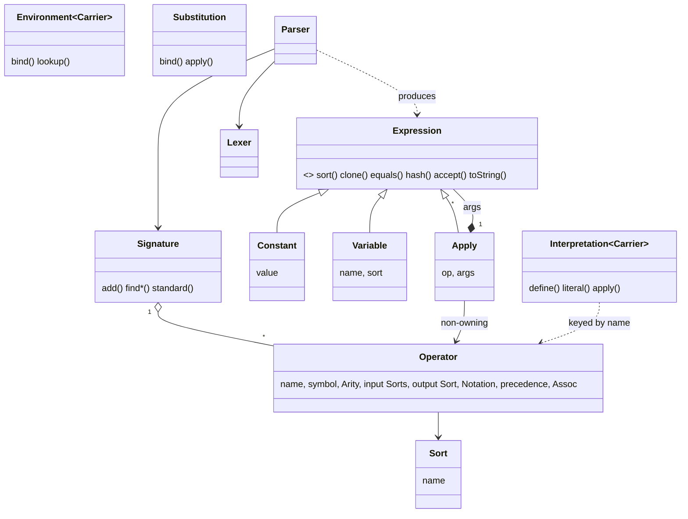

# Core (symbolic expressions) Architecture

`core` is the syntax layer of cppmath: immutable term trees, a vocabulary of operators, a parser and printer for them, and pluggable *interpretations* that give a tree a value. Status, contracts, roadmap and design rationale: [include/cppmath/core/PLAN.md](../../include/cppmath/core/PLAN.md).

The organising rule is **syntax is separate from semantics**. Nothing in the tree knows about `double` or `sin`; that knowledge lives in a `Signature` (shapes) and an `Interpretation` (meanings).

## Class overview



## Data flow

```
text --Lexer--> tokens --Parser (reads Signature)--> Expression tree
Expression --fold + Interpretation<C> + Environment<C>--> C        (evaluate)
Expression --transform--> Expression                               (substitute, simplify, differentiate)
Expression --Printer--> text            (toString; parse(print(e)) equals e)
```

## Key points

- **One node kind for all operations.** `Apply(op, args)` replaces a class per operator. Adding an operator is one `Signature::add()`; the parser, printer and evaluator pick it up with no other change. Its constructor checks arity and argument sorts, so every `Apply` is well-sorted.
- **Signature outlives expressions.** `Apply` stores a `const Operator*`. `Signature::standard()` is a function-local static and always safe. Equality compares operators by *name*, so trees built from a copied/extended Signature still match.
- **`fold` is the one traversal.** Evaluation, printing, `free_variables`, `node_count` and `tree_depth` are all folds. `transform` is the bottom-up rewrite behind `Substitution`.
- **Canonical text.** `toString()` is fully parenthesised (`(x + 1)`, `sin(x)`, `(-x)`) and numbers use the shortest text that parses back exactly (`utils::format_number`, shared with `sets`), so `parse(e.toString())` equals `e`. For that to hold, a `Constant` is never negative (negatives are `neg(literal)`) and a `Variable` can't be named like an atom (`pi`, `e`).
- **Evaluation errors.** Unbound variable or undefined operator: `std::out_of_range`. Bad domain (`1/0`, `log(0)`, `sqrt(-1)`, NaN `pow`): `std::invalid_argument`. Parse failures: `ParseError` (an `invalid_argument` carrying a `SourceSpan`).
- **Standard precedence** (loosest to tightest): `+ -` (10), `* /` (20), prefix `-` (30), `^` (40, right-assoc). So `-x^2` is `-(x^2)` and `-x*y` is `(-x)*y`.

## Example

```cpp
using namespace cppmath::core;
auto e = parse::Parser().parse("x^2 + 3*x + 1");   // (((x ^ 2) + (3 * x)) + 1)
Environment<double> env;  env.bind("x", 2.0);
double v = evaluate_real(*e, env);                  // 11

Substitution s;  s.bind("x", *build::add(build::var("t"), build::num(1)));
auto shifted = s.apply(*e);                         // x replaced by (t + 1)
```

A second algebra needs only a new `Interpretation<Carrier>` (see `test_evaluate.cpp`, integers mod 7).
