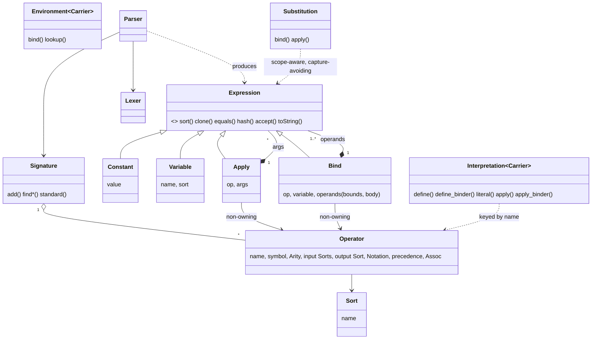

# Core (symbolic expressions) Architecture

`core` is the syntax layer of cppmath: immutable term trees, a vocabulary of operators, a parser and printer for them, and pluggable *interpretations* that give a tree a value. Status, contracts, roadmap and design rationale: [include/cppmath/core/PLAN.md](../../include/cppmath/core/PLAN.md).

The organising rule is **syntax is separate from semantics**. Nothing in the tree knows about `double` or `sin`; that knowledge lives in a `Signature` (shapes) and an `Interpretation` (meanings).

## Class overview



## Data flow

```
text --Lexer--> tokens --Parser (reads Signature)--> Expression tree
Expression --Interpretation<C> + Environment<C>--> C               (evaluate; binder bodies are evaluated lazily, per value)
Expression --fold--> anything                                      (print, free_variables, node_count, ...)
Expression --Substitution--> Expression                            (scope-aware, capture-avoiding)
Expression --simplify--> Expression                                (identities, exact constant folding)
Expression --calculus::differentiate--> Expression                 (rule table keyed by operator name, then simplify)
Expression --Printer--> text            (toString; parse(print(e)) equals e)
```

## Key points

- **One node kind for all operations.** `Apply(op, args)` replaces a class per operator. Adding an operator is one `Signature::add()`; the parser, printer and evaluator pick it up with no other change. Its constructor checks arity and argument sorts, so every `Apply` is well-sorted.
- **Signature outlives expressions.** `Apply` stores a `const Operator*`. `Signature::standard()` is a function-local static and always safe. Equality compares operators by *name*, so trees built from a copied/extended Signature still match.
- **`fold` is the traversal for results.** Printing, `free_variables`, `node_count` and `tree_depth` are folds. `transform` is a bottom-up rewrite, but it is not scope-aware, so `Substitution` has its own recursion.
- **Binders.** `sum(i, lo, hi, body)` is a `Bind`: the variable is in scope only in the body (the last operand), never in the bounds. That is why `evaluate` is a visitor rather than a fold (the body is evaluated once per value, in a child `Environment`), why `free_variables` subtracts the variable from the body only, and why `Substitution` never replaces a shadowed variable and renames a binder's variable (`i` → `i_1`) only when a replacement would otherwise be captured. Compare trees up to renaming with `alpha_equivalent`; `equals()` is syntactic.
- **Reserved words.** Atoms, function names and binder names cannot be variable names, since the printed text would parse back as something else.
- **Canonical text.** `toString()` is fully parenthesised (`(x + 1)`, `sin(x)`, `(-x)`) and numbers use the shortest text that parses back exactly (`utils::format_number`, shared with `sets`), so `parse(e.toString())` equals `e`. For that to hold, a `Constant` is never negative (negatives are `neg(literal)`) and a `Variable` can't be named like an atom (`pi`, `e`).
- **Evaluation errors.** Unbound variable or undefined operator: `std::out_of_range`. Bad domain (`1/0`, `log(0)`, `sqrt(-1)`, NaN `pow`): `std::invalid_argument`. Parse failures: `ParseError` (an `invalid_argument` carrying a `SourceSpan`).
- **Consumers live outside core.** `abstract_algebra::example::finite_field_interpretation` evaluates a parsed tree in Z/pZ; `calculus::differentiate` uses a rule table keyed by operator name (copy `DerivativeRules::standard()` and `define` a rule for a new operator); `core::simplify` tidies results. Dependencies point toward `core`, never from it.
- **Standard precedence** (loosest to tightest): `+ -` (10), `* /` (20), prefix `-` (30), `^` (40, right-assoc). So `-x^2` is `-(x^2)` and `-x*y` is `(-x)*y`.

## Example

```cpp
using namespace cppmath::core;
auto e = parse::Parser().parse("x^2 + 3*x + 1");   // (((x ^ 2) + (3 * x)) + 1)
Environment<double> env;  env.bind("x", 2.0);
double v = evaluate_real(*e, env);                  // 11

Substitution s;  s.bind("x", *build::add(build::var("t"), build::num(1)));
auto shifted = s.apply(*e);                         // x replaced by (t + 1)
```

A second algebra needs only a new `Interpretation<Carrier>`: see `finite_field_interpretation` (Z/pZ), `test_evaluate.cpp` (integers mod 7), and `examples/core_demo.cpp`, which evaluates one parsed expression in ℝ and in 𝔽₇.

```cpp
auto f = parse::Parser().parse("sum(i, 1, n, i * x)");        // a binder: i is local to the body
auto df = calculus::differentiate(*f, "x");                     // sum(i, 1, n, i)
Substitution capture;  capture.bind("x", *parse::Parser().parse("i"));
capture.apply(*f)->toString();                                  // sum(i_1, 1, n, (i_1 * i)): i renamed, new i stays free
```
